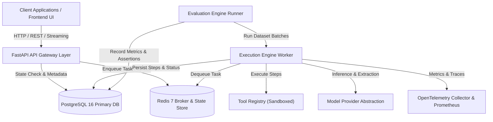
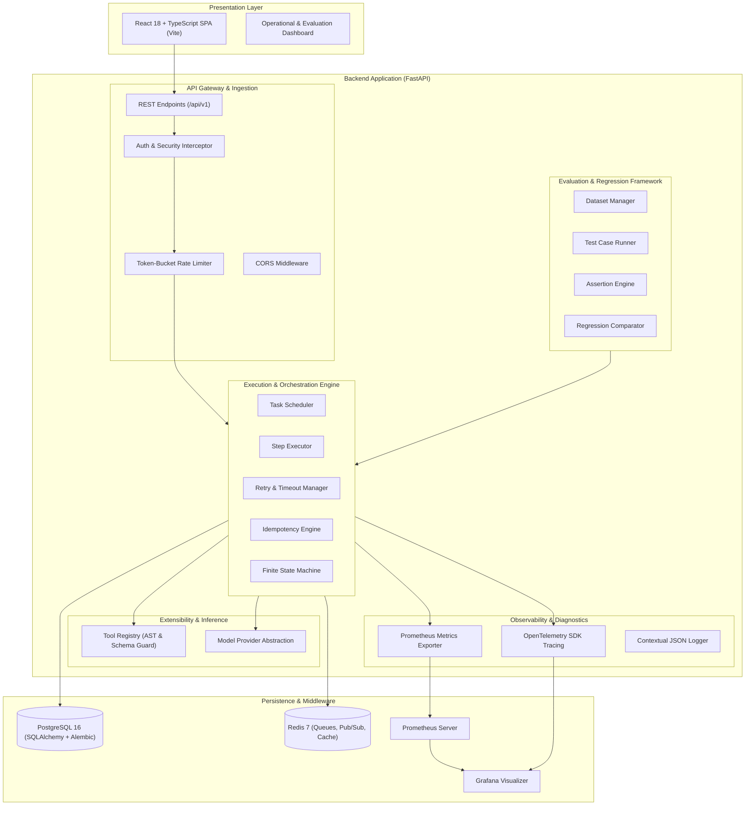
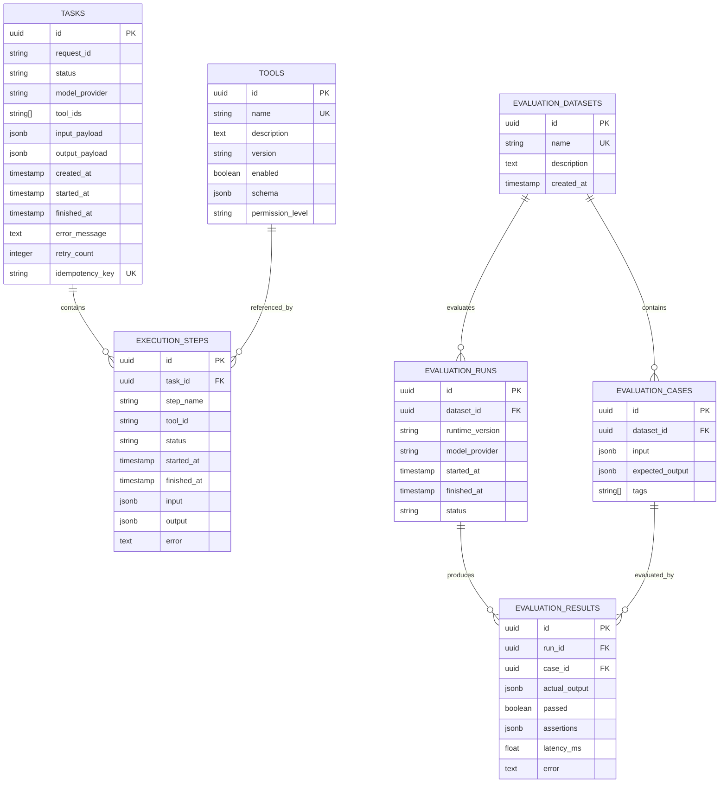
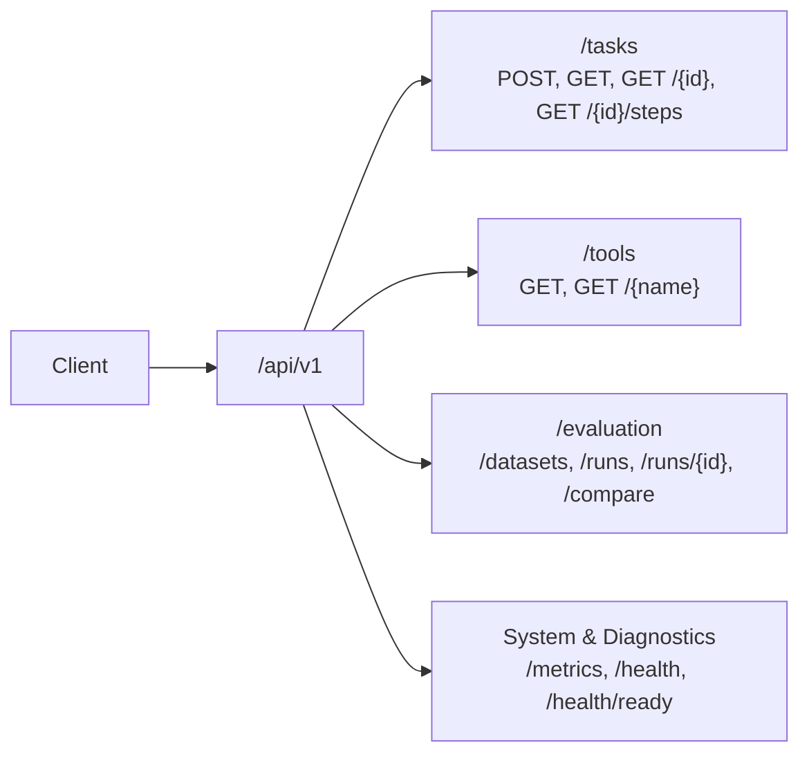
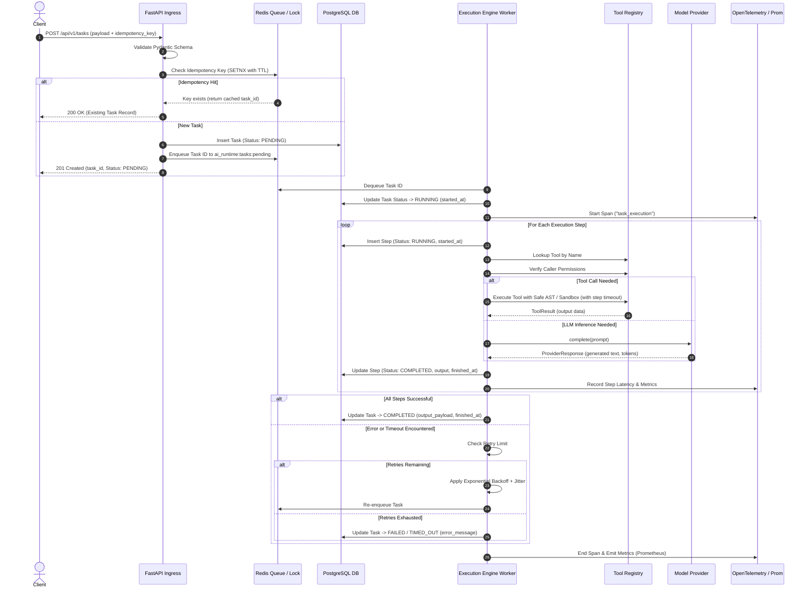
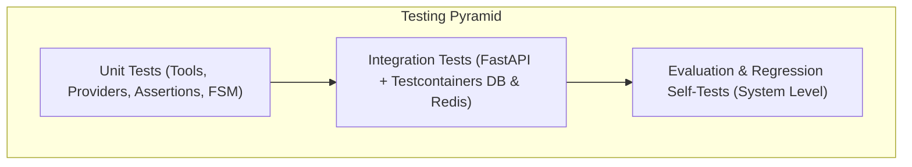
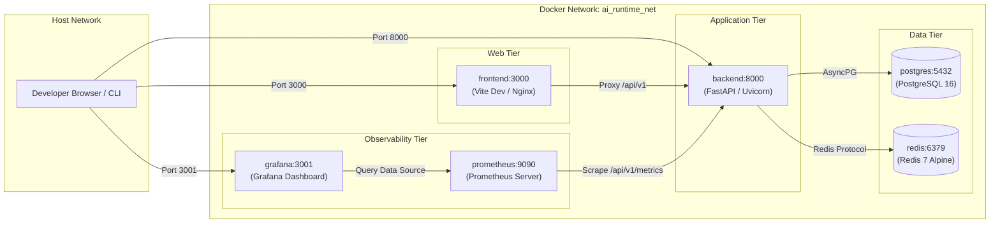

# AI Runtime & Evaluation Platform — System Architecture

**Document Version:** 1.0.0  
**Status:** Active / Production Baseline  
**Target Architecture:** Distributed Asynchronous AI Execution & Evaluation Platform  

---

## 1. System Overview

The **AI Runtime & Evaluation Platform** is a developer-centric, high-observability execution runtime and evaluation engine designed for artificial intelligence workloads. It provides a hardened, deterministic environment for orchestrating multi-step AI tasks, managing tool invocations, benchmark-evaluating model outputs against ground truth datasets, and streaming telemetry to modern observability suites.



### 1.1 Core Mission & Value Proposition
Modern LLM-powered applications often suffer from non-deterministic execution paths, unmanaged latency variance, hidden tool failures, and regressions across model versions. The AI Runtime & Evaluation Platform bridges the gap between ad-hoc AI scripting and resilient production engineering through:

1. **Controlled Execution Engine:** Enforces explicit state machines, timeout budgets, idempotency checks, and automated exponential backoff retries.
2. **Deterministic Tool Registry:** Implements strict contract-driven tool execution with AST-parsed safe math, schema verification, and permission boundaries.
3. **Automated Evaluation Framework:** Empowers engineers to benchmark prompts, tools, and model adapters against versioned evaluation datasets with automated regression diffs.
4. **Deep Observability:** Emits first-class OpenTelemetry distributed traces, Prometheus metrics, and structured JSON logs to illuminate every internal step.
5. **Zero-Dependency Local Development:** Offers completely deterministic mock providers and tools allowing the entire platform to run offline without paid external API keys.

---

## 2. Component Architecture

The platform follows a modular, decoupled service architecture where ingestion, scheduling, tool execution, and observability are segregated into distinct boundaries.



### 2.1 API Layer (FastAPI)
The API Layer serves as the primary ingress point for clients, management scripts, and continuous integration pipelines:
- **Framework:** FastAPI built on top of Starlette and Uvicorn, leveraging Python asynchronous coroutines (`async`/`await`).
- **Request Validation:** Automated input parsing, coercion, and structural validation powered by Pydantic V2 schemas. Rejects malformed JSON with HTTP 422 before reaching business logic.
- **Middleware Pipeline:**
  - `RequestIdMiddleware`: Generates or propagates an `X-Request-ID` UUID per request for correlation across logs, spans, and database entries.
  - `RateLimitMiddleware`: Token-bucket rate limiting backed by Redis sliding logs or memory fallback (`RATE_LIMIT_REQUESTS_PER_MINUTE=60`).
  - `CORSMiddleware`: Whitelists specific origins (`CORS_ORIGINS`) to prevent unauthorized cross-origin requests from web browsers.
  - `AuthenticationMiddleware`: Pluggable authentication interceptor. In local development mode (`ENABLE_AUTH=false`), bypasses authentication while attaching a synthetic identity; in production mode, verifies asymmetric JWT bearer tokens or `X-API-Key` headers.

### 2.2 Execution Engine
The Execution Engine is responsible for the resilient, deterministic execution of task workflows:
- **Task Scheduler:** Manages concurrency bounds (`MAX_CONCURRENT_TASKS=10`), queuing tasks into Redis lists (`ai_runtime:tasks:pending`) and popping tasks for asynchronous execution.
- **Step Executor:** Walks through ordered execution steps. Resolves step dependencies, passes upstream outputs to downstream inputs, and enforces per-step timeouts.
- **Retry & Timeout Manager:** Wraps step invocations in `asyncio.wait_for` using individual tool timeout configurations (`CALCULATOR_TIMEOUT_SECONDS`, etc.) and system defaults (`DEFAULT_TASK_TIMEOUT_SECONDS=30`). Applies exponential backoff with randomized jitter on transient errors (`MAX_RETRY_ATTEMPTS=3`).
- **Idempotency Checker:** Prevents duplicate task executions caused by network retries. Keys on client-provided `idempotency_key` or hashed payload signatures stored in Redis (`SETNX`) with TTL. If a duplicate arrives while processing or completed, the existing task status/result is returned immediately.
- **Finite State Machine:** Enforces valid lifecycle transitions:
  $$\text{PENDING} \longrightarrow \text{RUNNING} \longrightarrow \{\text{COMPLETED} \mid \text{FAILED} \mid \text{TIMED\_OUT}\}$$

### 2.3 Tool Registry
The Tool Registry acts as a sandbox and discovery directory for functional capabilities invoked during task execution:
- **Interface Contract (`BaseTool`):** Abstract class mandating `name`, `description`, `version`, `permission_level`, `input_schema`, and `execute(params) -> ToolResult`.
- **Built-in Tools:**
  1. `Calculator`: Deterministic mathematical expression evaluator using Python's `ast` (Abstract Syntax Tree) module. Parses numbers and binary operators (`+`, `-`, `*`, `/`, `**`, `%`) without ever executing `eval()` or `exec()`.
  2. `TextProcessor`: Text transformation tool providing operations such as word count, token estimation, regex matching/extraction, casing transformations, and text chunking.
  3. `KnowledgeBase`: In-memory and pgvector-backed key-value search engine enabling retrieval of ground-truth context documents.
  4. `MockTool`: Configurable mock tool that echoes parameters, introduces artificial latency, or throws simulated errors for deterministic chaos testing.
- **Permission Boundaries:** Every tool declares a permission level (`PUBLIC`, `AUTHENTICATED`, `ADMIN`). The engine verifies the caller's authorized context prior to execution.
- **Schema Validation:** Tool inputs and outputs are validated strictly against Pydantic models derived from JSON Schema.

### 2.4 Provider Abstraction Layer
The Model Provider layer insulates application logic from specific vendor implementations:
- **`ModelProvider` Interface:** Declares standardized asynchronous methods:
  - `generate(prompt: str, options: ProviderOptions) -> ProviderResponse`
  - `tokenize(text: str) -> int`
  - `health_check() -> bool`
- **Adapters:**
  - `MockProvider`: Default provider requiring no network access or external credentials. Provides deterministic canned responses, token counting heuristics, and predictable outputs for testing and CI pipelines.
  - `OpenAIProvider`: Production adapter utilizing the official asynchronous OpenAI client. Gated by `OPENAI_API_KEY`; enabled when the environment variable is present and `DEFAULT_MODEL_PROVIDER=openai`.
  - `GeminiProvider`: Google Gemini adapter utilizing the Google Generative AI SDK. Gated by `GEMINI_API_KEY`; enabled when the environment variable is configured.
- **Resilience:** Automatic fallback handling, connection pooling, and circuit breaking across upstream LLM endpoints.

### 2.5 Evaluation Engine
The Evaluation Engine provides automated quantitative benchmarking of models, prompts, and tool pipelines:
- **Dataset Manager:** Manages versioned test suites containing curated test cases (`input_payload` and `expected_output`).
- **Case Runner:** Concurrently runs dataset test cases through the Execution Engine under controlled model provider configurations.
- **Assertion Engine:** Evaluates execution outputs using modular assert types:
  - `exact_match`: String equality check.
  - `contains`: Substring inclusion.
  - `regex`: Pattern matching against expected regular expressions.
  - `json_schema`: Verifies that structured output conforms to a target JSON Schema.
  - `threshold`: Verifies numeric outputs fall within bounded tolerances.
- **Metrics Aggregator:** Computes pass rates, aggregate latency statistics (p50, p95, p99), token consumption, and failure classifications across runs.
- **Regression Comparator:** Computes differential metrics between two evaluation run IDs (`run_a` vs `run_b`), flagging accuracy regressions, newly failing cases, latency spikes, and breaking output deviations.

### 2.6 Observability Layer
Production-grade instrumentation embedded throughout the execution path:
- **OpenTelemetry SDK:** Generates distributed trace spans for every HTTP request, task execution, tool call, and model inference invocation. Propagates W3C `traceparent` headers.
- **Prometheus Metrics Exporter:** Scrapes custom runtime telemetry via `/api/v1/metrics`:
  - `ai_runtime_tasks_total`: Counter partitioned by `status` and `model_provider`.
  - `ai_runtime_task_duration_seconds`: Histogram measuring end-to-end task execution latency.
  - `ai_runtime_step_duration_seconds`: Histogram measuring execution duration per tool name.
  - `ai_runtime_active_tasks`: Gauge of currently executing concurrent tasks.
  - `ai_runtime_tool_errors_total`: Counter of tool failures partitioned by tool and error code.
- **Structured JSON Logging:** Python `logging` customized to emit machine-readable JSON logs to stdout. Automatically injects `request_id`, `task_id`, `span_id`, and `trace_id`. Implements configurable payload redaction (`PAYLOAD_LOG_LEVEL=metadata_only`).

### 2.7 Data Layer
- **PostgreSQL 16:** Primary transactional store storing tasks, execution steps, tool definitions, evaluation datasets, cases, runs, and results.
- **SQLAlchemy 2.0 (Async):** Asynchronous ORM utilizing `asyncpg` driver for non-blocking I/O operations.
- **Alembic:** Version-controlled database schema migrations running in forward and backward directions.
- **Redis 7:** In-memory store utilized for task queues, idempotency locks, sliding-window rate limiting, and pub/sub log broadcasting.

### 2.8 Frontend Architecture
- **Framework:** React 18 single-page application built with TypeScript and Vite.
- **UI Components:** Clean, accessible design system styled with Tailwind CSS and Lucide React icons.
- **State Management:** TanStack React Query for server-state caching, synchronization, and automatic background re-fetching; Zustand for client-side operational state.
- **API Client:** Type-safe HTTP client targeting `/api/v1` with automatic request-id propagation and standardized error handling.

---

## 3. Data Model

The relational schema is implemented in PostgreSQL with strict foreign keys, cascade protections, UUID primary keys, and JSONB payloads for flexible task parameters.



### 3.1 Entity Specifications

#### Table: `tasks`
Stores top-level execution requests submitted by users or upstream systems.
| Column | Type | Constraints | Description |
| :--- | :--- | :--- | :--- |
| `id` | UUID | PRIMARY KEY, default `gen_random_uuid()` | Unique task identifier |
| `request_id` | VARCHAR(64) | NOT NULL, INDEX | Distributed trace and request correlation ID |
| `status` | VARCHAR(20) | NOT NULL, INDEX | Status: `PENDING`, `RUNNING`, `COMPLETED`, `FAILED`, `TIMED_OUT` |
| `model_provider` | VARCHAR(32) | NOT NULL | Provider used (`mock`, `openai`, `gemini`) |
| `tool_ids` | TEXT[] | NOT NULL DEFAULT '{}' | List of tool names or IDs allowed for this task |
| `input_payload` | JSONB | NOT NULL | User input parameters, prompts, and context |
| `output_payload` | JSONB | NULLABLE | Resulting final payload upon completion |
| `created_at` | TIMESTAMPTZ | NOT NULL, default `NOW()` | Submission timestamp |
| `started_at` | TIMESTAMPTZ | NULLABLE | Execution start timestamp |
| `finished_at` | TIMESTAMPTZ | NULLABLE | Execution termination timestamp |
| `error_message` | TEXT | NULLABLE | Failure description or stack summary if failed |
| `retry_count` | INTEGER | NOT NULL DEFAULT 0 | Number of retry attempts executed |
| `idempotency_key` | VARCHAR(128) | NULLABLE, UNIQUE INDEX | Client idempotency identifier |

#### Table: `execution_steps`
Stores fine-grained step executions that comprise a parent task.
| Column | Type | Constraints | Description |
| :--- | :--- | :--- | :--- |
| `id` | UUID | PRIMARY KEY, default `gen_random_uuid()` | Unique step execution ID |
| `task_id` | UUID | NOT NULL, FK `tasks(id)` ON DELETE CASCADE | Parent task reference |
| `step_name` | VARCHAR(64) | NOT NULL | Human-readable identifier of the execution step |
| `tool_id` | VARCHAR(64) | NULLABLE | Identifier of the tool executed (if applicable) |
| `status` | VARCHAR(20) | NOT NULL | `PENDING`, `RUNNING`, `COMPLETED`, `FAILED` |
| `started_at` | TIMESTAMPTZ | NOT NULL | Step initiation timestamp |
| `finished_at` | TIMESTAMPTZ | NULLABLE | Step completion timestamp |
| `input` | JSONB | NOT NULL | Input parameters passed to this specific step |
| `output` | JSONB | NULLABLE | Output data returned by the step |
| `error` | TEXT | NULLABLE | Error message captured during step execution |

#### Table: `evaluation_datasets`
Collections of test cases used to benchmark model accuracy and performance.
| Column | Type | Constraints | Description |
| :--- | :--- | :--- | :--- |
| `id` | UUID | PRIMARY KEY, default `gen_random_uuid()` | Unique dataset identifier |
| `name` | VARCHAR(128) | NOT NULL, UNIQUE | Dataset name |
| `description` | TEXT | NULLABLE | Human-readable documentation of the dataset scope |
| `created_at` | TIMESTAMPTZ | NOT NULL, default `NOW()` | Creation timestamp |

#### Table: `evaluation_cases`
Individual input-expectation pairs belonging to a dataset.
| Column | Type | Constraints | Description |
| :--- | :--- | :--- | :--- |
| `id` | UUID | PRIMARY KEY, default `gen_random_uuid()` | Unique test case identifier |
| `dataset_id` | UUID | NOT NULL, FK `evaluation_datasets(id)` ON DELETE CASCADE | Parent dataset reference |
| `input` | JSONB | NOT NULL | Task parameters representing test input |
| `expected_output` | JSONB | NOT NULL | Ground-truth assertions and expected values |
| `tags` | TEXT[] | NOT NULL DEFAULT '{}' | Category tags for filtering (e.g., `["math", "edge-case"]`) |

#### Table: `evaluation_runs`
An execution execution pass of a dataset against a runtime configuration.
| Column | Type | Constraints | Description |
| :--- | :--- | :--- | :--- |
| `id` | UUID | PRIMARY KEY, default `gen_random_uuid()` | Unique evaluation run identifier |
| `dataset_id` | UUID | NOT NULL, FK `evaluation_datasets(id)` | Dataset under evaluation |
| `runtime_version` | VARCHAR(32) | NOT NULL | Platform software version |
| `model_provider` | VARCHAR(32) | NOT NULL | Provider evaluated during run (`mock`, `openai`, `gemini`) |
| `started_at` | TIMESTAMPTZ | NOT NULL, default `NOW()` | Start timestamp |
| `finished_at` | TIMESTAMPTZ | NULLABLE | Completion timestamp |
| `status` | VARCHAR(20) | NOT NULL | `RUNNING`, `COMPLETED`, `FAILED` |

#### Table: `evaluation_results`
Individual case execution outcomes within an evaluation run.
| Column | Type | Constraints | Description |
| :--- | :--- | :--- | :--- |
| `id` | UUID | PRIMARY KEY, default `gen_random_uuid()` | Result record ID |
| `run_id` | UUID | NOT NULL, FK `evaluation_runs(id)` ON DELETE CASCADE | Evaluation run reference |
| `case_id` | UUID | NOT NULL, FK `evaluation_cases(id)` | Associated test case reference |
| `actual_output` | JSONB | NULLABLE | Output produced by the model or tool pipeline |
| `passed` | BOOLEAN | NOT NULL | `true` if all assertions passed, else `false` |
| `assertions` | JSONB | NOT NULL | Granular result breakdown for each assertion rule |
| `latency_ms` | FLOAT | NOT NULL | Execution latency in milliseconds |
| `error` | TEXT | NULLABLE | Execution error string if case raised an exception |

#### Table: `tools`
Registry catalogue defining registered capabilities and their security permissions.
| Column | Type | Constraints | Description |
| :--- | :--- | :--- | :--- |
| `id` | UUID | PRIMARY KEY, default `gen_random_uuid()` | Unique tool ID |
| `name` | VARCHAR(64) | NOT NULL, UNIQUE | Canonical tool name (e.g., `calculator`) |
| `description` | TEXT | NOT NULL | Human and model readable tool documentation |
| `version` | VARCHAR(16) | NOT NULL | Semantic version (e.g., `1.0.0`) |
| `enabled` | BOOLEAN | NOT NULL DEFAULT true | Flag enabling or disabling tool globally |
| `schema` | JSONB | NOT NULL | Formal JSON Schema definition for arguments |
| `permission_level` | VARCHAR(20) | NOT NULL DEFAULT 'AUTHENTICATED' | `PUBLIC`, `AUTHENTICATED`, or `ADMIN` |

---

## 4. API Boundaries

All platform services expose standardized RESTful interfaces under the `/api/v1` route prefix. Responses strictly adhere to standardized JSON formats with RFC 7807 error representations for exceptional conditions.



### 4.1 Endpoint Catalog

| HTTP Method | Path | Request Body | Status Codes | Description | Permission |
| :--- | :--- | :--- | :--- | :--- | :--- |
| `POST` | `/api/v1/tasks` | `TaskCreateRequest` | `201 Created`, `400`, `422`, `429` | Submits task for asynchronous execution. Supports idempotency key header. | `AUTHENTICATED` |
| `GET` | `/api/v1/tasks` | *None* (Query params: `limit`, `offset`, `status`) | `200 OK` | Paginated listing of recorded tasks. | `AUTHENTICATED` |
| `GET` | `/api/v1/tasks/{id}` | *None* | `200 OK`, `404 Not Found` | Retrieves complete status and output payload for task. | `AUTHENTICATED` |
| `GET` | `/api/v1/tasks/{id}/steps`| *None* | `200 OK`, `404 Not Found` | Retrieves ordered list of execution steps for task. | `AUTHENTICATED` |
| `GET` | `/api/v1/tools` | *None* | `200 OK` | Lists all registered tools with schemas and statuses. | `PUBLIC` |
| `GET` | `/api/v1/tools/{name}` | *None* | `200 OK`, `404 Not Found` | Detailed specification and parameter schema for tool. | `PUBLIC` |
| `POST` | `/api/v1/evaluation/datasets` | `DatasetCreateRequest` | `201 Created`, `400`, `422` | Creates a new evaluation dataset and test cases. | `ADMIN` |
| `GET` | `/api/v1/evaluation/datasets` | *None* (Query params: `limit`, `offset`) | `200 OK` | Lists all existing evaluation datasets. | `AUTHENTICATED` |
| `POST` | `/api/v1/evaluation/runs` | `EvaluationRunRequest` | `201 Created`, `404`, `422` | Triggers an evaluation run over a specified dataset. | `AUTHENTICATED` |
| `GET` | `/api/v1/evaluation/runs` | *None* (Query params: `dataset_id`) | `200 OK` | Lists historical evaluation runs. | `AUTHENTICATED` |
| `GET` | `/api/v1/evaluation/runs/{id}` | *None* | `200 OK`, `404 Not Found` | Retrieves run summary and individual case results. | `AUTHENTICATED` |
| `GET` | `/api/v1/evaluation/runs/{id}/compare/{other_id}` | *None* | `200 OK`, `404 Not Found` | Performs differential analysis comparing two runs. | `AUTHENTICATED` |
| `GET` | `/api/v1/metrics` | *None* | `200 OK` | Prometheus scrape endpoint (plain text format). | `ADMIN` / Internal |
| `GET` | `/api/v1/health` | *None* | `200 OK` | Liveness probe indicating process availability. | `PUBLIC` |
| `GET` | `/api/v1/health/ready` | *None* | `200 OK`, `503 Service Unavailable`| Readiness probe verifying DB and Redis connectivity. | `PUBLIC` |

### 4.2 Standard Error Response Format
All error payloads follow the RFC 7807 specification:
```json
{
  "type": "https://errors.airuntime.dev/task-timeout",
  "title": "Task Execution Timed Out",
  "status": 504,
  "detail": "Task execution exceeded the configured limit of 30 seconds.",
  "instance": "/api/v1/tasks/d3b07384-d113-4a1e-8e8f-7f7267f5c56d",
  "request_id": "req-98f5a2b1-4c12",
  "timestamp": "2026-10-25T02:50:00Z"
}
```

---

## 5. Execution Lifecycle

Task execution proceeds through an orchestrated lifecycle balancing asynchronous scaling, state persistence, safety boundaries, and deep telemetry collection.



### 5.1 Lifecycle Phase Breakdown
1. **Ingestion & Validation:** Request arrives at FastAPI. Pydantic schema validation verifies types, required fields, and boundary constraints.
2. **Idempotency Gate:** Checks Redis for existing `idempotency_key`. If matched, returns previous result; otherwise creates a distributed lock.
3. **Queueing:** Task is persisted in PostgreSQL with state `PENDING` and its UUID pushed to the Redis list `ai_runtime:tasks:pending`.
4. **Worker Acquisition:** Worker pops task, records `started_at`, marks status `RUNNING`, and initializes the root OpenTelemetry trace span.
5. **Step Execution Loop:**
   - Evaluates step parameters and resolves input bindings.
   - Verifies tool exists and caller possesses required authorization level (`PUBLIC`, `AUTHENTICATED`, `ADMIN`).
   - Executes step wrapped in `asyncio.wait_for(..., timeout=tool_timeout)`.
   - Records step input, output, duration, and status in `execution_steps`.
6. **Task Finalization:** Task is flagged `COMPLETED`, `FAILED`, or `TIMED_OUT`. Execution metrics (latency, active tasks, error counters) are recorded in Prometheus.

---

## 6. Security Boundaries

Security is established across every tier of the runtime architecture through defensive isolation and least-privilege principles:

1. **No Arbitrary Code Execution:** The platform strictly prohibits evaluating untrusted code. Mathematical expressions run through an AST syntax parser that whitelist-validates nodes (`ast.Expression`, `ast.BinOp`, `ast.UnaryOp`, `ast.Constant`) without exposing Python builtins (`eval`, `exec`, `__import__`).
2. **Tool Permissions Enforced:** Tools register explicit access tiers (`PUBLIC`, `AUTHENTICATED`, `ADMIN`). Calls exceeding the client context's authorization rank are rejected with HTTP 403 Forbidden.
3. **Zero Secret Leakage:** Sensitive tokens (`OPENAI_API_KEY`, `GEMINI_API_KEY`, `POSTGRES_PASSWORD`, `SECRET_KEY`) are read exclusively from environment variables and are filtered out of structured logs and response payloads via sanitization masks.
4. **CORS Isolation:** The HTTP gateway validates browser origins against explicit whitelist settings (`CORS_ORIGINS`), blocking unauthorized cross-origin requests.
5. **Token-Bucket Rate Limiting:** Enforces request quotas (`RATE_LIMIT_REQUESTS_PER_MINUTE=60`) via sliding windows in Redis to safeguard against denial-of-service and brute force abuse.
6. **Strict Input Schema Validation:** All payloads are validated using Pydantic V2 schemas before entering the business layer, preventing prototype pollution, type confusion, and buffer overflows.
7. **SQL Injection Immunity:** All persistent operations utilize SQLAlchemy 2.0 ORM with asynchronous parameterized queries; raw dynamic SQL construction is prohibited.
8. **Pluggable Authentication Support:** While disabled by default in local developer environments (`ENABLE_AUTH=false`) for seamless onboarding, the core architecture includes turnkey hooks to activate JWT Bearer and API Key authentication in production.

---

## 7. Testing Strategy

The test architecture ensures high reliability and deterministic verification across all system components.



### 7.1 Testing Tiers
- **Unit Tests (`backend/tests/unit`):**
  - Isolated testing of all built-in tools (`Calculator`, `TextProcessor`, `KnowledgeBase`, `MockTool`).
  - Validation of AST parser security against code injection payloads (e.g., `__import__('os').system('ls')`).
  - Verification of provider abstractions and fallback logic using `MockProvider`.
  - Comprehensive unit coverage for evaluation assertion algorithms (regex, exact match, JSON schema, thresholds).
- **Integration Tests (`backend/tests/integration`):**
  - Full API lifecycle tests executed using `httpx.AsyncClient` against real PostgreSQL and Redis test instances.
  - Verification of idempotency deduplication under concurrent submissions.
  - Validation of Alembic migrations applying cleanly forward and backwards.
  - Rate limiting verification using mocked Redis clocks.
- **Frontend Component & Integration Tests (`frontend/src`):**
  - Component unit tests using Vitest and React Testing Library.
  - Mock Service Worker (MSW) simulating backend REST contracts to verify UI state transitions and error toast renderings.
- **Evaluation Self-Tests (Dogfooding):**
  - Automated CI test jobs execute the Evaluation Engine against baseline regression datasets.
  - Verifies that new platform releases do not regress parsing precision, tool dispatch accuracy, or metric aggregation.

---

## 8. Deployment Architecture

The entire platform is deployable locally and in continuous integration environments via Docker Compose, establishing an isolated container network.



### 8.1 Docker Compose Services
1. **`backend`**: Python 3.14 / FastAPI runtime. Exposes port `8000`. Mounts code for live-reload in development. Configured via environment variables.
2. **`frontend`**: Node 24 / Vite React application. Exposes port `3000`. Provides reverse-proxy routing to `backend` for local development.
3. **`postgres`**: Official PostgreSQL 16 image. Exposes port `5432` to host. Persistent data backed by Docker volume `pgdata`.
4. **`redis`**: Official Redis 7 Alpine image. Exposes port `6379` to host. Configured with append-only persistence backed by Docker volume `redisdata`.
5. **`prometheus`**: Scrapes `/api/v1/metrics` every 15 seconds. Exposes port `9090`. Configured via `deployment/prometheus/prometheus.yml`.
6. **`grafana`**: Provisioned with pre-configured dashboards visualizing task execution rates, latencies, tool failures, and resource utilization. Exposes port `3001`.

## Dashboard and telemetry delivery

The frontend is a React single-page application. In development, Vite proxies `/api` to the FastAPI service. In the container deployment, Nginx serves the built SPA and reverse-proxies `/api/` to the backend service, keeping API calls same-origin from the browser.

The backend exposes Prometheus metrics at `/api/v1/metrics`. When `OTEL_ENABLED=true`, optional OpenTelemetry instrumentation adds FastAPI and SQLAlchemy spans; the runtime task service adds a task execution span. In Docker Compose, the OTLP Collector receives traces and forwards them to Jaeger. If the collector is not enabled or available, the platform remains usable; telemetry is an optional operational capability.
