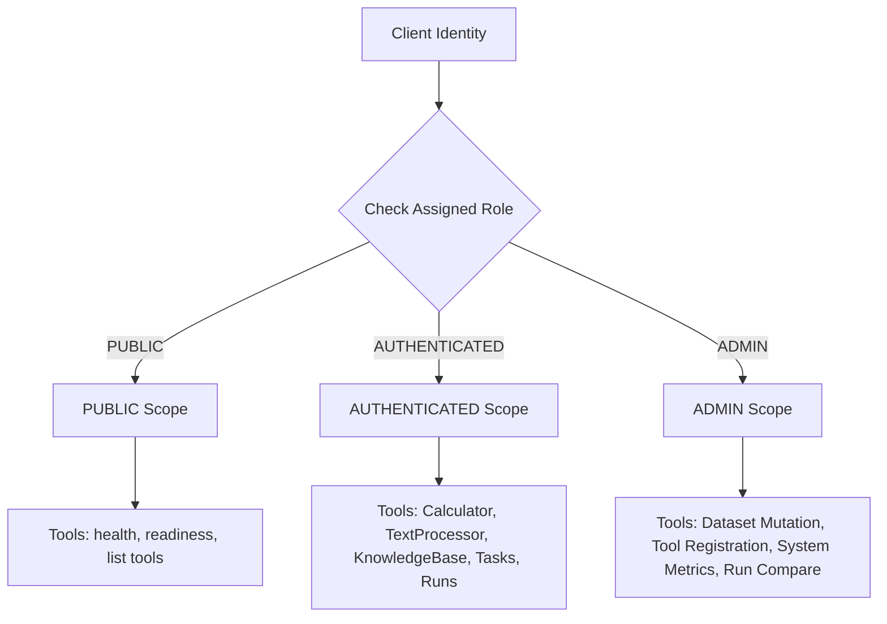

# Security Policy & Implementation Guide

**Document Version:** 1.0.0  
**Status:** Active / Production Baseline  
**Target Architecture:** AI Runtime & Evaluation Platform  

---

> [!WARNING]
> **LOCAL DEVELOPMENT DEFAULT SETTINGS ARE NOT HARDENED FOR PRODUCTION**  
> By default, `ENABLE_AUTH=false` in development to facilitate friction-free local iteration. Under this configuration, the platform performs no cryptographic authentication, and all requests are granted elevated privileges. **NEVER bind `0.0.0.0` or expose the development configuration directly to untrusted networks or the public internet.** Review the [Safe Path to Production Hardening](#10-safe-path-to-production-hardening) section before deploying this software.

---

## 1. Security Model: Development vs. Production

The platform implements a multi-tiered security perimeter with two operational operating modes:

```mermaid
flowchart TD
    subgraph LocalDev["Local Development Mode (ENABLE_AUTH=false)"]
        ClientDev["Developer / Test Suite"] -->|"Direct HTTP"| APIDev["FastAPI Ingress"]
        APIDev -->|"Synthetic Dev User Context"| EngineDev["Execution Engine"]
        EngineDev -->|"Mock / Sandboxed Tools"| ToolsDev["Local Tools & Mock Provider"]
    end

    subgraph Production["Production Mode (ENABLE_AUTH=true)"]
        ClientProd["Authenticated User / Client App"] -->|"HTTPS + TLS 1.3"| WAF["Reverse Proxy / WAF / Ingress"]
        WAF -->|"Rate-Limited Request"| APIProd["FastAPI Ingress"]
        APIProd -->|"Verify JWT / API Key"| AuthGuard["Authentication Middleware"]
        AuthGuard -->|"RBAC Permission Check"| EngineProd["Execution Engine"]
        EngineProd -->|"Sandboxed Tools"| ToolsProd["Tools Registry"]
        EngineProd -->|"Gated API Keys"| ProvidersProd["External LLM Providers"]
    end
```



| Dimension | Local Development Mode (`ENABLE_AUTH=false`) | Production Mode (`ENABLE_AUTH=true`) |
| :--- | :--- | :--- |
| **Authentication** | Disabled. Synthetic developer identity (`dev-user`) automatically injected. | Enforced. Cryptographic validation of Bearer JWTs or API keys. |
| **Authorization** | All permission levels granted (`ADMIN` tier access). | Role-Based Access Control (`PUBLIC`, `AUTHENTICATED`, `ADMIN`). |
| **TLS / Transport** | Plain HTTP (`http://localhost:8000`). | Strict HTTPS (TLS 1.2+ / TLS 1.3) via reverse proxy. |
| **CORS Policy** | Permissive for `localhost:3000` and `localhost:5173`. | Strict origin whitelisting (`CORS_ORIGINS`). |
| **Model Providers** | Deterministic `MockProvider` (zero external calls). | Gated external providers (OpenAI, Gemini) with strict quotas. |
| **Logging Sanitization**| Relaxed for debugging; payloads visible if configured. | Mandatory payload masking and PII redaction. |

---

## 2. Authentication Architecture

When `ENABLE_AUTH=true` is enabled, the API gateway validates credentials on every incoming request prior to dispatching route handlers.

### 2.1 Authentication Mechanisms
The platform supports two authentication strategies:
1. **JSON Web Tokens (JWT):** Passed via the `Authorization: Bearer <token>` header. Used by user interfaces and human sessions. Tokens must be signed using asymmetric (RS256) or symmetric (HS256) keys and contain valid `sub`, `exp`, and `roles` claims.
2. **API Keys:** Passed via the `X-API-Key: <key>` header. Used by automated pipelines, background workers, and CI/CD evaluations. API keys are stored in the database exclusively as cryptographic hashes (SHA-256 with salt) and compared using constant-time string comparison (`secrets.compare_digest`).

### 2.2 Enabling Production Authentication
To enable authentication in your environment:

1. Update `.env`:
   ```bash
   ENABLE_AUTH=true
   SECRET_KEY=use_openssl_rand_hex_32_to_generate_a_secure_production_secret
   ACCESS_TOKEN_EXPIRE_MINUTES=60
   ```

2. FastAPI middleware verification flow:
   ```python
   # Architectural contract for authentication enforcement
   from fastapi import Depends, HTTPException, Security, status
   from fastapi.security import HTTPAuthorizationCredentials, HTTPBearer, APIKeyHeader
   import os

   security_bearer = HTTPBearer(auto_error=False)
   security_api_key = APIKeyHeader(name="X-API-Key", auto_error=False)

   async def get_current_user(
       bearer_auth: HTTPAuthorizationCredentials = Security(security_bearer),
       api_key: str = Security(security_api_key),
   ) -> UserContext:
       # If auth disabled for local development:
       if os.getenv("ENABLE_AUTH", "false").lower() != "true":
           return UserContext(user_id="dev-user", role="ADMIN", is_authenticated=True)

       # 1. Check API Key
       if api_key:
           user = await verify_api_key(api_key)
           if user:
               return user

       # 2. Check Bearer Token
       if bearer_auth and bearer_auth.credentials:
           user = await verify_jwt_token(bearer_auth.credentials)
           if user:
               return user

       raise HTTPException(
           status_code=status.HTTP_401_UNAUTHORIZED,
           detail="Missing or invalid authentication credentials",
           headers={"WWW-Authenticate": "Bearer"},
       )
   ```

---

## 3. Authorization & Tool Permission Levels

The platform enforces Role-Based Access Control (RBAC) across API endpoints and tool invocations.



### 3.1 Permission Hierarchy

| Permission Tier | Description | Accessible Operations & Tools |
| :--- | :--- | :--- |
| **`PUBLIC`** | Unauthenticated callers or basic discovery clients. | `/health`, `/health/ready`, `GET /tools`, `GET /tools/{name}`. |
| **`AUTHENTICATED`** | Registered users or authenticated service accounts. | Submitting tasks, retrieving task outputs, viewing execution steps, invoking `Calculator`, `TextProcessor`, `KnowledgeBase`, executing evaluation runs. |
| **`ADMIN`** | Platform administrators and trusted operations teams. | Tool registration and lifecycle management, dataset mutations (`POST /evaluation/datasets`), comparison endpoints, `/metrics` Prometheus scrape endpoint. |

### 3.2 Enforcement in Tool Execution
Prior to invoking any tool method, the `ToolRegistry` evaluates the caller's context against the tool's declared permission boundary:

```python
def check_tool_permission(user_context: UserContext, tool: BaseTool) -> None:
    tier_weights = {"PUBLIC": 1, "AUTHENTICATED": 2, "ADMIN": 3}
    user_weight = tier_weights.get(user_context.role, 0)
    required_weight = tier_weights.get(tool.permission_level, 3)

    if user_weight < required_weight:
        raise PermissionDeniedError(
            f"User '{user_context.user_id}' with role '{user_context.role}' "
            f"is not authorized to execute tool '{tool.name}' (requires '{tool.permission_level}')."
        )
```

---

## 4. Secrets Management

The platform adheres to a zero-secret codebase policy:

1. **Environment Variables Exclusively:** All sensitive secrets—including `SECRET_KEY`, `POSTGRES_PASSWORD`, `OPENAI_API_KEY`, and `GEMINI_API_KEY`—are loaded at runtime through environment variables.
2. **Exclusion from Source Control:** The root `.gitignore` strictly excludes `.env`, `.env.local`, `.env.*.local`, credentials files, and PEM certificates.
3. **Template Documentation Only:** The `.env.example` file contains sanitized placeholders and descriptive instructions, containing no production secrets or real API credentials.
4. **Memory Hygiene:** Secrets are loaded into structured Pydantic settings (`pydantic-settings`) and never logged, mirrored to disk, or serialized into client error payloads.
5. **Secret Rotation Protocol:**
   - Database credentials: Update PostgreSQL credentials and backend `DATABASE_URL` synchronously during planned maintenance.
   - Provider API keys: Rotate OpenAI/Gemini keys without platform downtime by updating container environment variables and performing rolling restarts.
   - JWT Secret: Support dual-key verification during rollover windows to allow active client tokens to expire naturally.

---

## 5. Input Validation & Sandboxing

Unsanitized user inputs are a primary attack vector in AI applications. The runtime implements multi-layer defense against code injection and data poisoning.

### 5.1 Strict Pydantic Schema Validation
All request bodies, query parameters, and step inputs are strictly validated against Pydantic V2 models with `extra = "forbid"` enabled. Unexpected fields are rejected with HTTP 422.

### 5.2 Prevention of Arbitrary Code Execution (Zero `eval` / `exec`)
The runtime explicitly prohibits the execution of arbitrary scripts or untrusted code:
- **Calculator Tool:** Mathematical expression evaluation is strictly performed by parsing Python's Abstract Syntax Tree (`ast.parse`) in `eval` mode, walking the resulting syntax tree, and validating each AST node against a strict whitelist:
  - Allowed AST nodes: `ast.Expression`, `ast.BinOp`, `ast.UnaryOp`, `ast.Constant`, `ast.Add`, `ast.Sub`, `ast.Mult`, `ast.Div`, `ast.Pow`, `ast.Mod`, `ast.USub`, `ast.UAdd`.
  - Disallowed nodes: `ast.Call`, `ast.Attribute`, `ast.Import`, `ast.ImportFrom`, `ast.Name`, `ast.Lambda`.
  - Any attempt to invoke functions (e.g., `__import__('os').system(...)`) raises a security exception immediately before execution.
- **TextProcessor Tool:** String transformations operate solely on native string methods and bounded regular expressions compiled with timeouts to prevent ReDoS (Regular Expression Denial of Service).
- **KnowledgeBase Tool:** Key retrieval uses parameterized queries or in-memory dictionary maps, preventing SQL or NoSQL injection.

---

## 6. Payload Logging & Privacy Policy

Task inputs and outputs often contain proprietary, confidential, or sensitive personal data. The platform implements a configurable telemetry logging policy.

### 6.1 Logging Levels (`PAYLOAD_LOG_LEVEL`)
- **`none`:** Payloads are completely excluded from logs, OpenTelemetry trace span attributes, and metric tags. Only task metadata (`id`, `request_id`, `status`, `duration_ms`) is retained.
- **`metadata_only` (Default Recommended):** Records execution metrics, payload byte sizes, key counts, and input token counts. Raw text and parameter values are stripped before telemetry ingestion.
- **`full`:** Full payload contents are logged. Strictly restricted to local development or sandbox environments.

### 6.2 Automated PII & Token Redaction
The logging interceptor and telemetry exporter pass payloads through automated regex scrubbers that redact sensitive information:
- Authorization headers (`Bearer eyJ...` $\rightarrow$ `Bearer [REDACTED]`)
- API keys (`sk-[a-zA-Z0-9]{32,}` $\rightarrow$ `[REDACTED_API_KEY]`)
- Credit card numbers $\rightarrow$ `[REDACTED_CC]`
- Email addresses $\rightarrow$ `[REDACTED_EMAIL]`

### 6.3 Data Retention & Purging
The `EXECUTION_RETENTION_DAYS` configuration governs the retention of raw execution records in PostgreSQL. A scheduled background cleanup worker deletes tasks and execution steps older than the specified retention window (default: 30 days; 0 = indefinite).

---

## 7. Dependency Security & Supply Chain Protection

1. **Version Pinning:** All backend Python dependencies are explicitly pinned with versions in `pyproject.toml` / `requirements.txt`. Frontend dependencies are locked with `package-lock.json`.
2. **Automated Vulnerability Scanning:**
   - **Dependabot:** Configured via `.github/dependabot.yml` to perform weekly scans of Python pip and npm packages, automatically generating pull requests for security advisories.
   - **CI Security Scans:** GitHub Actions workflows execute `pip-audit` for Python dependencies and `npm audit --audit-level=high` for Node dependencies on every pull request.
3. **Container Base Image Hardening:**
   - Docker images utilize minimal, audited base images (`python:3.14-slim`, `node:24-alpine`).
   - Containers run as non-root users (`uid 10001`) with read-only root filesystems where applicable.

---

## 8. Reporting Vulnerabilities

We take security issues seriously and welcome responsible disclosure from researchers and users.

- **Security Contact:** `security@airuntime.dev` (placeholder: replace with your organization's security team address)
- **Response Timeline:**
  - Initial acknowledgment: Within 24 hours.
  - Triage and severity assessment: Within 72 hours.
  - Remediation patch and disclosure: Coordinated based on severity (critical vulnerabilities targeted within 7 days).
- **Safe Harbor Policy:** We will not pursue legal action against security researchers who conduct testing in accordance with good-faith responsible disclosure principles:
  - Do not exploit vulnerabilities to access or exfiltrate private data.
  - Do not disrupt or degrade production service availability (no DoS testing).
  - Provide reasonable notice before any public disclosure.

---

## 9. Known Security Limitations (Local Dev Warning)

When running the project in its default local development state, be aware of the following architectural defaults:

1. **Authentication is Disabled (`ENABLE_AUTH=false`):** Any client capable of reaching port 8000 has unrestricted administrative control over the execution engine, database records, and tool catalog.
2. **Default Database Credentials:** The provided `.env.example` lists default development passwords (`CHANGE_ME_IN_PRODUCTION`). If left unchanged on an exposed network, unauthorized access to PostgreSQL is possible.
3. **Local Permissive CORS:** CORS is configured to permit `localhost:3000` and `localhost:5173`. If run on a shared network or remote workstation, browser-based requests could originate from malicious local sites.
4. **AST Sandbox Scope:** While the AST mathematical parser prevents Python function calls and attribute access, it is designed for mathematical evaluation, not general-purpose sandboxing of untrusted Python code.

---

## 10. Safe Path to Production Hardening

Before deploying the AI Runtime & Evaluation Platform to staging or production environments, complete the following hardening checklist:

- [ ] **1. Enable Authentication:**
  - Set `ENABLE_AUTH=true` in production environment variables.
  - Generate a cryptographically random secret: `openssl rand -hex 32` and set `SECRET_KEY`.
  - Configure token expiration (`ACCESS_TOKEN_EXPIRE_MINUTES=60`).
- [ ] **2. Rotate Database & Infrastructure Credentials:**
  - Provision unique, high-entropy passwords for `POSTGRES_PASSWORD`.
  - Enable password authentication or IAM authentication for PostgreSQL and Redis.
- [ ] **3. Enforce TLS 1.3 / HTTPS:**
  - Place backend and frontend behind an ingress controller or reverse proxy (Nginx, Traefik, AWS ALB, Cloudflare).
  - Terminate TLS with valid certificates (Let's Encrypt or corporate CA).
  - Enable HTTP Strict Transport Security (HSTS) headers.
- [ ] **4. Restrict Network Access:**
  - Ensure PostgreSQL (port 5432) and Redis (port 6379) are only accessible within the private Docker network or VPC subnet; do NOT publish their ports to the public host.
  - Restrict the Prometheus metrics endpoint (`/api/v1/metrics`) to internal monitoring scrapers.
- [ ] **5. Configure Restrictive CORS:**
  - Set `CORS_ORIGINS` to the exact production domain(s) hosting the frontend (e.g., `https://runtime.example.com`).
- [ ] **6. Configure Rate Limiting & Web Application Firewall:**
  - Set `RATE_LIMIT_ENABLED=true` and tune `RATE_LIMIT_REQUESTS_PER_MINUTE` according to expected traffic.
  - Deploy WAF rules blocking SQL injection, XSS, and payload anomalies.
- [ ] **7. Restrict Payload Logging:**
  - Set `PAYLOAD_LOG_LEVEL=metadata_only` or `none` to prevent storing confidential user prompts and responses in log files.
- [ ] **8. Run Containers as Non-Root:**
  - Ensure backend and frontend Docker containers execute under dedicated non-root users (`USER appuser`).
