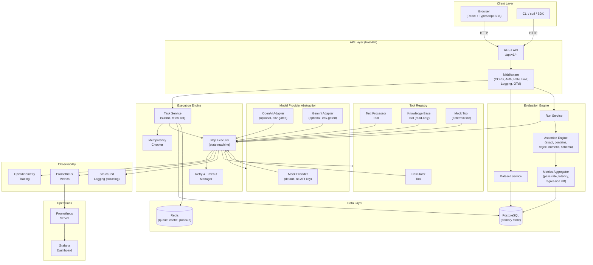
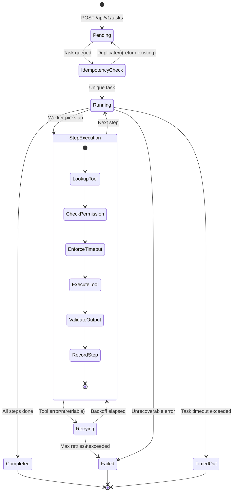
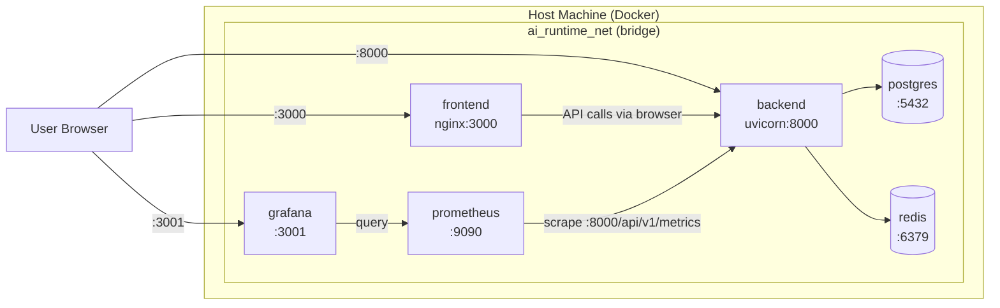

# Architecture Diagrams

This directory contains architecture diagrams for the AI Runtime & Evaluation Platform.

## System Architecture

## Execution Lifecycle

## Data Model

```mermaid
erDiagram
    TASKS {
        uuid id PK
        string request_id UK
        string idempotency_key UK
        string status
        string model_provider
        jsonb tool_ids
        jsonb input_payload
        jsonb output_payload
        timestamp created_at
        timestamp started_at
        timestamp finished_at
        string error_message
        int retry_count
        int token_usage_input
        int token_usage_output
        float estimated_cost_usd
    }

    EXECUTION_STEPS {
        uuid id PK
        uuid task_id FK
        string step_name
        string status
        timestamp started_at
        timestamp finished_at
        jsonb input
        jsonb output
        string error
        int attempt_number
    }

    TOOLS {
        uuid id PK
        string name UK
        string description
        string version
        bool enabled
        jsonb input_schema
        jsonb output_schema
        string permission_level
        int timeout_seconds
    }

    EVALUATION_DATASETS {
        uuid id PK
        string name UK
        string description
        timestamp created_at
        timestamp updated_at
    }

    EVALUATION_CASES {
        uuid id PK
        uuid dataset_id FK
        jsonb input
        jsonb expected_output
        string[] tags
        timestamp created_at
    }

    EVALUATION_RUNS {
        uuid id PK
        uuid dataset_id FK
        string runtime_version
        string model_provider
        string status
        timestamp started_at
        timestamp finished_at
        jsonb config
    }

    EVALUATION_RESULTS {
        uuid id PK
        uuid run_id FK
        uuid case_id FK
        jsonb actual_output
        bool passed
        jsonb assertions
        float latency_ms
        string error
    }

    TASKS ||--o{ EXECUTION_STEPS : "has"
    EVALUATION_DATASETS ||--o{ EVALUATION_CASES : "contains"
    EVALUATION_DATASETS ||--o{ EVALUATION_RUNS : "evaluated by"
    EVALUATION_RUNS ||--o{ EVALUATION_RESULTS : "produces"
    EVALUATION_CASES ||--o{ EVALUATION_RESULTS : "tested by"
```

## Deployment (Docker Compose)

